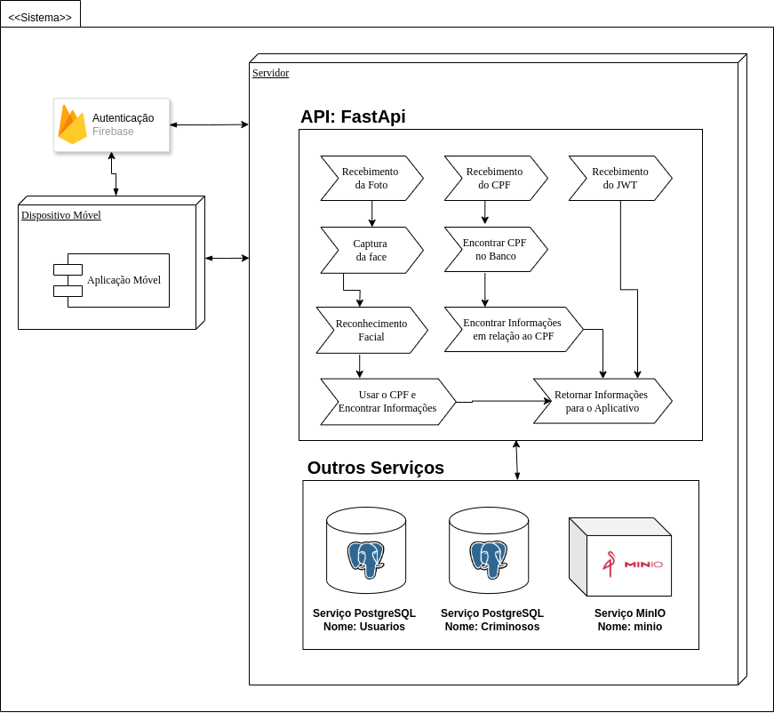

<h1 align="center"> VisionApp - API </h1>

<div align="center">


</div>

## Sumário

* [Integrantes](#integrantes)
* [Descrição](#descrição)
* [Requisitos](#requisitos)
* [Tecnologias](#tecnologias)
* [Fluxo do Software](#fluxo-do-software)
* [Endpoints](#endpoints)
* [Tabelas](#tabelas)
* [Como Executar](#como-executar)
* [CI e Qualidade](#ci-e-qualidade)
* [Ambiente de Testes](#ambiente-de-testes)

## Integrantes

- Anderson do Vale - [and3510](https://github.com/and3510)
- Beatriz Barreto - [whosbea](https://github.com/whosbea)
- Cristovam Paulo - [cristovam10000](https://github.com/cristovam10000)
- Gustavo do Vale - [gustavodovale](https://github.com/gustavodovale)
- Lucas Cesar - [lucascesar1107](https://github.com/lucascesar1107)
- Nicolas Leao - [Furvos](https://github.com/Furvos)

## Descrição

API desenvolvida com FastAPI para reconhecimento facial e consulta de fichas criminais, consumida pelo aplicativo [VisionApp - Mobile](https://github.com/visionapp-projeto/visionapp-app-mobile). A API recebe a foto capturada pelo policial, gera o vetor facial, compara com as identidades cadastradas e retorna os dados da pessoa e sua ficha criminal. Toda consulta (por foto ou por CPF) é registrada com a matrícula do policial para fins de auditoria.

A autenticação é feita via **Keycloak**: o aplicativo obtém o token pelo fluxo OIDC + PKCE e a API valida o JWT (RS256) usando as chaves públicas (JWKS) do provedor.

## Requisitos

### Requisitos Funcionais (RF)

| Código | Requisito |
|--------|-----------|
| RF01 | O sistema deve armazenar **identidades** com CPF, nome, nome da mãe, nome do pai, data de nascimento, indicação de gêmeo, imagem facial e vetor facial. |
| RF02 | O sistema deve permitir a **extração automática da face** a partir da imagem enviada. |
| RF03 | O sistema deve **gerar um vetor de 128 dimensões** representando a face da pessoa. |
| RF04 | O sistema deve vincular a **ficha criminal** e os **crimes** a uma identidade (CPF) já cadastrada. |
| RF05 | O sistema deve permitir o **reconhecimento facial** por similaridade com os vetores cadastrados, classificando o resultado como *confiante*, *ambíguo* ou *nenhuma similaridade forte*. |
| RF06 | O sistema deve aplicar **ajuste de iluminação (CLAHE)** na imagem antes do reconhecimento. |
| RF07 | O sistema deve permitir a **consulta de informações por CPF**, retornando a identidade, a ficha criminal e os crimes com seu status (Em Aberto / Foragido). |
| RF08 | O sistema deve retornar erro quando **nenhum rosto for detectado** na imagem enviada. |
| RF09 | O sistema deve aceitar apenas requisições autenticadas com **token JWT emitido pelo Keycloak**, validando assinatura (RS256) e *audience*. |
| RF10 | O sistema deve **registrar cada consulta** (por foto e por CPF) com a matrícula e o identificador do policial, a data/hora e o resultado. |
| RF11 | O sistema deve segmentar as informações em dois bancos: **ssp_usuario** (registros de consulta) e **ssp_criminosos** (identidades e fichas criminais). |
| RF12 | O sistema deve retornar a foto de referência da identidade por meio de **URL temporária (presigned) do MinIO**. |

### Requisitos Não Funcionais (RNF)

| Código | Requisito |
|--------|-----------|
| RNF01 | O sistema deve ser desenvolvido em **Python**, utilizando **FastAPI** como framework principal. |
| RNF02 | O banco de dados utilizado deve ser o **PostgreSQL** com a extensão `pgvector` para armazenar os vetores faciais. |
| RNF03 | O sistema deve usar **OpenCV, dlib e face_recognition** para manipulação e vetorização facial. |
| RNF04 | Todas as comunicações entre cliente e servidor devem ocorrer via **HTTPS** (terminação TLS no Traefik). |
| RNF05 | O sistema deve seguir os princípios de **segurança de dados**, evitando exposição de informações sensíveis. |
| RNF06 | O sistema deve ser executado em **containers Docker**, permitindo escalar a API horizontalmente. |
| RNF07 | O tempo médio de resposta para reconhecimento facial deve ser inferior a **3 segundos**. |
| RNF08 | A API deve seguir boas práticas REST, com respostas em **formato JSON**. |
| RNF09 | O sistema deve estar preparado para lidar com **falhas de rede, imagem inválida ou ausência de rosto**. |

## Tecnologias

- Python 3.11
- FastAPI
- Keycloak (OIDC / JWT RS256)
- PostgreSQL 17 + pgvector
- MinIO
- Docker e Docker Compose
- Traefik
- SonarQube

### Bibliotecas principais

- **FastAPI** – Framework para construção da API.
- **OpenCV** – Leitura e pré-processamento de imagens (CLAHE).
- **dlib** – Detecção facial.
- **face_recognition** – Geração dos vetores faciais (descritores de 128 dimensões).
- **SQLAlchemy + pgvector** – ORM e mapeamento da coluna vetorial.
- **python-jose** – Validação do JWT emitido pelo Keycloak.
- **boto3** – Integração com o MinIO (API compatível com S3).

## Fluxo do Software

<div align="center">



</div>

1. O aplicativo autentica o policial no **Keycloak** e envia o token JWT em cada requisição.
2. A API valida o token pelas chaves públicas (JWKS) do Keycloak.
3. **Por foto:** a imagem recebe ajuste de iluminação (CLAHE), o rosto é detectado e convertido em um vetor de 128 dimensões, e esse vetor é comparado (distância euclidiana) com os vetores cadastrados:
   - distância **< 0,4** → `confiante`: retorna a identidade e a ficha criminal;
   - distância **< 0,5** → `ambíguo`: retorna todas as identidades possíveis para o policial decidir;
   - acima disso → `nenhuma similaridade forte`.
4. **Por CPF:** a API busca a identidade, a ficha criminal e os crimes vinculados.
5. A consulta é registrada no banco `ssp_usuario`, a foto de referência é obtida no MinIO (URL temporária) e o resultado volta ao aplicativo.

## Endpoints

Todos os endpoints exigem o header `Authorization: Bearer <token>`.

| Método | Rota | Corpo | Descrição |
|--------|------|-------|-----------|
| `POST` | `/buscar-similaridade-foto/` | `multipart/form-data`: `matricula`, `file` | Reconhecimento facial a partir de uma foto |
| `POST` | `/buscar-ficha-criminal/` | JSON: `{ "cpf": "...", "matricula": "..." }` | Consulta de identidade e ficha criminal por CPF |

> As rotas de cadastro (`create-identidade`, `delete-identidade`, `update-ficha`, `create-crime`) existem em `functions/crud/`, mas estão desabilitadas no `main.py`.

A documentação interativa (Swagger) fica disponível em `/docs`.

## Tabelas

### Banco `ssp_criminosos`

<div align="center">


</div>

| Tabela | Campos |
|--------|--------|
| `identidade` | `cpf` (PK), `nome`, `nome_mae`, `nome_pai`, `data_nascimento`, `vetor_facial` (VECTOR 128), `url_facial`, `gemeo` |
| `ficha_criminal` | `id_ficha` (PK), `cpf`, `vulgo` |
| `crime` | `id_crime` (PK), `id_ficha`, `nome_crime`, `artigo`, `descricao`, `data_ocorrencia`, `cidade`, `estado`, `status` (`Em Aberto` / `Foragido`) |

### Banco `ssp_usuario`

Os dados dos policiais ficam no Keycloak; este banco guarda apenas os registros de consulta.

| Tabela | Campos |
|--------|--------|
| `log_resultado_reconhecimento` | `id_ocorrido`, `matricula`, `id_usuario`, `distancia`, `cpf`, `id_ficha`, `status_reconhecimento`, `data_ocorrido`, `url_facial_referencia` |
| `log_resultado_cpf` | `id_ocorrido`, `matricula`, `id_usuario`, `cpf`, `id_ficha`, `data_ocorrido` |

As tabelas são criadas automaticamente pelo SQLAlchemy na inicialização da API.

## Como Executar

### Com Docker Compose

O `docker-compose.yml` sobe a API, os dois bancos PostgreSQL e o MinIO, e usa uma rede externa `web` compartilhada com o Traefik (que não faz parte deste compose).

```bash
docker network create web            # caso ainda não exista
cp .env.example docker/.env          # preencha as variáveis
cd docker
docker compose up -d
```

### Localmente

Requer Python 3.11 e as ferramentas de compilação do dlib (`build-essential`, `cmake`).

```bash
python -m venv .venv && source .venv/bin/activate
pip install -r requirements.txt
cp .env.example .env                 # preencha as variáveis
uvicorn main:app --reload
```

### Variáveis de ambiente

| Variável | Descrição |
|----------|-----------|
| `SSP_USUARIO_DATABASE_URL` | URL de conexão do banco `ssp_usuario` |
| `SSP_CRIMINOSOS_DATABASE_URL` | URL de conexão do banco `ssp_criminosos` |
| `URL_MINIO`, `ACCESS_KEY_MINIO`, `SECRET_KEY_MINIO` | Endpoint e credenciais do MinIO |
| `FASTAPI_HOST`, `MINIO_HOST`, `MINIO_CONSOLE_HOST` | Hosts publicados pelo Traefik |
| `CERT_RESOLVER` | Resolver de certificados TLS do Traefik |
| `PG_CRIMINOSOS_PASSWORD`, `PG_USUARIOS_PASSWORD` | Senhas dos bancos PostgreSQL |
| `MINIO_ROOT_USER`, `MINIO_ROOT_PASSWORD` | Credenciais de administração do MinIO |

## CI e Qualidade

- **Dockerfile multi-stage**: compila as dependências nativas (dlib) em uma imagem de build e copia apenas o resultado para uma imagem `python:3.11-slim`.
- **GitHub Actions + SonarQube**: em todo pull request para `develop` ou `main`, o workflow roda os testes com `pytest` e cobertura, envia a análise ao SonarQube e verifica o Quality Gate.

## Ambiente de Testes

- **Sistema Operacional:** Ubuntu 22.04.5 LTS (x86_64)
- **Virtualização:** KVM/QEMU (pc-i440fx-9.0)
- **Kernel:** 5.15.0-134-generic
- **CPU:** AMD EPYC 9354P (2 vCPUs @ 3.25GHz)
- **Memória RAM:** 8 GB

